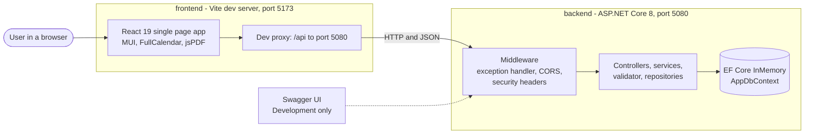
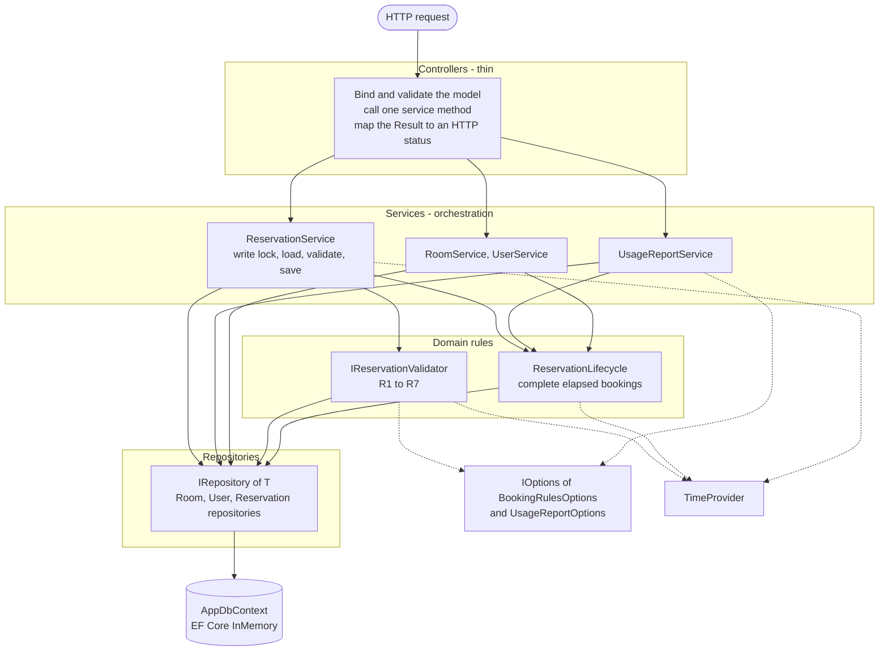
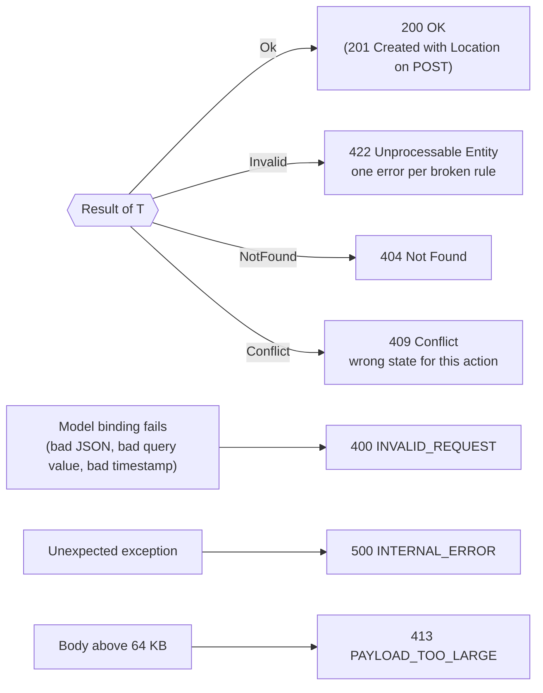
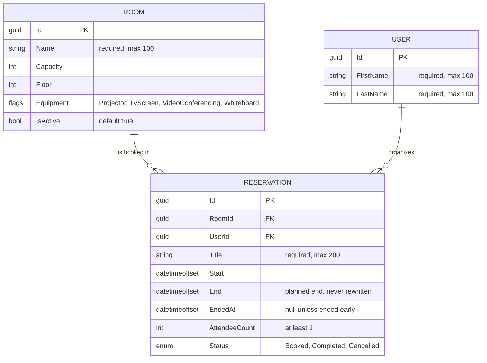
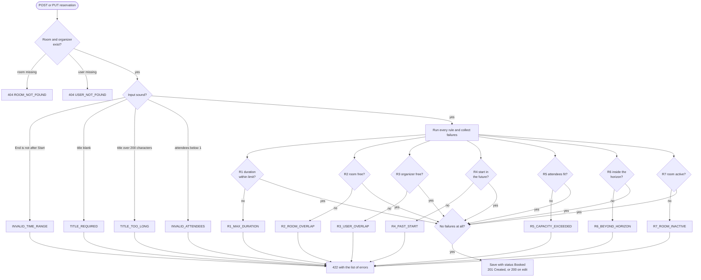
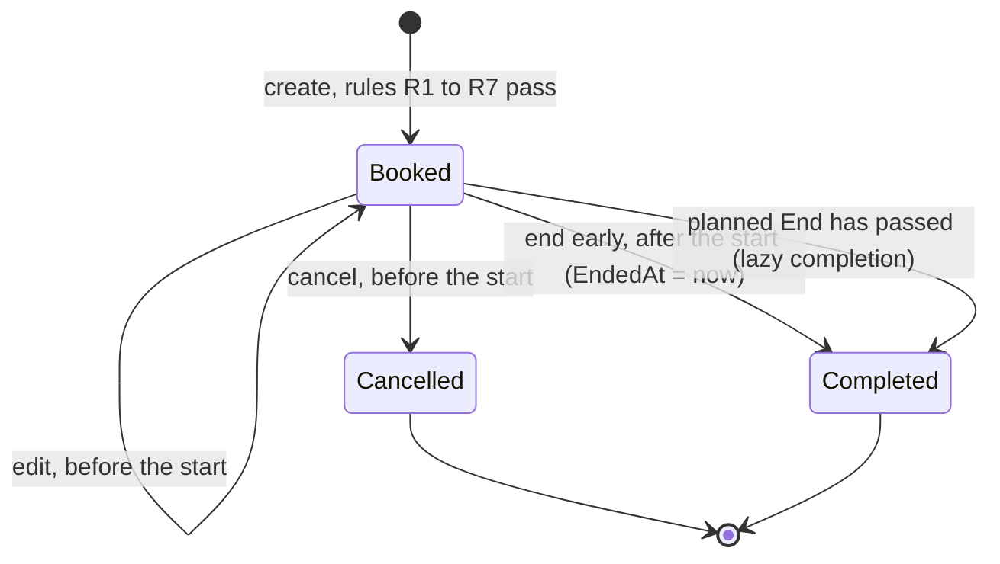
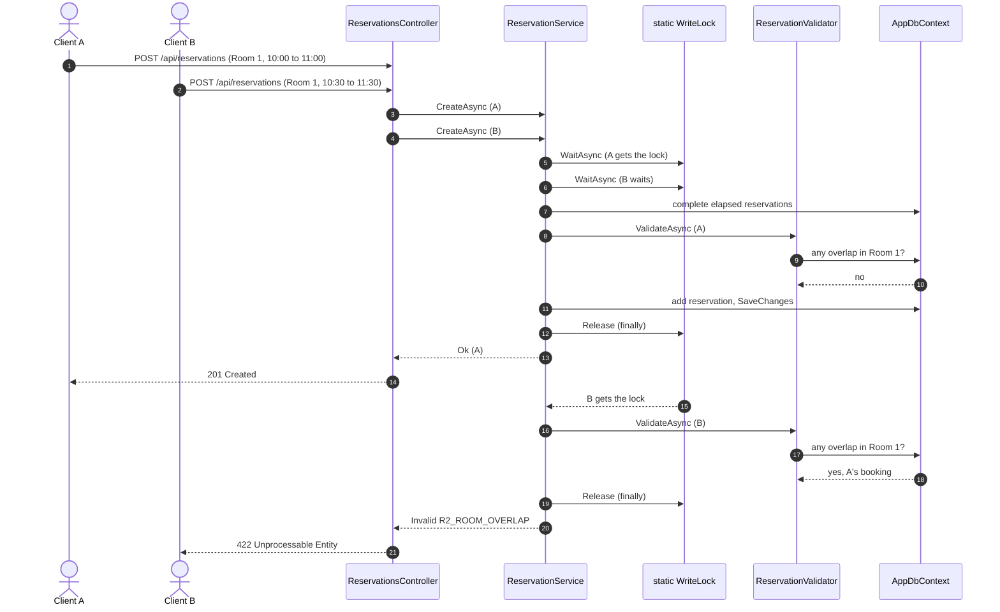
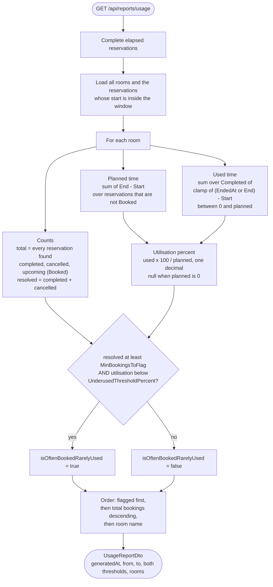
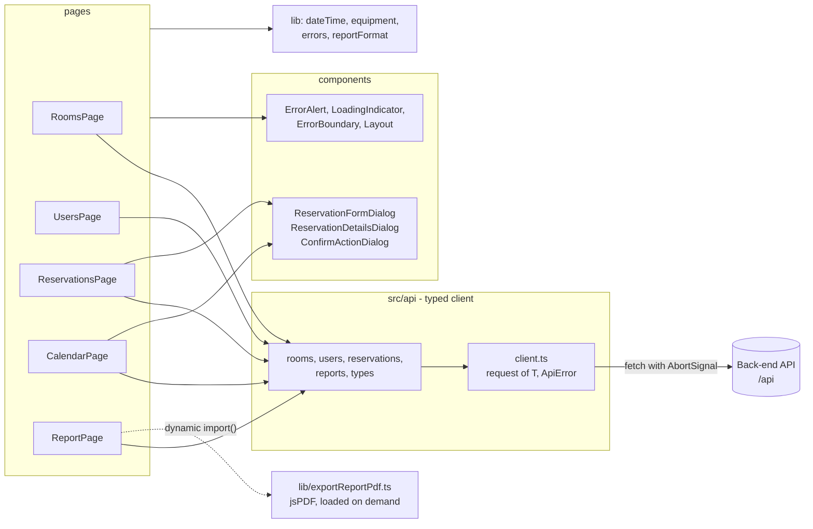

# Room Reservation System

A small, complete room booking application: an **ASP.NET Core 8** Web API and a **React + TypeScript** front end.
People can browse rooms, book them, change or cancel a booking, end a running meeting early, see a calendar for each
room, and read a usage report that answers one question: *which rooms are booked often but rarely used?*

This is an internship project, built in small steps (one numbered spec per pull request). The booking rules, the
lifecycle of a reservation and every number in the report are calculated **only in the back end**. The front end
shows what the API returns.

**Contents:** [Quick start](#quick-start) · [Requirement coverage](#requirement-coverage) · [Architecture](#architecture) ·
[Domain model](#domain-model) · [Booking rules](#booking-rules) · [Reservation lifecycle](#reservation-lifecycle) ·
[Concurrency](#concurrency) · [Usage report](#usage-report) · [API summary](#api-summary) · [Front end](#front-end) ·
[Configuration](#configuration) · [Project structure](#project-structure) · [Design decisions](#design-decisions) ·
[Design patterns](#design-patterns) · [Testing](#testing) · [Tools](#tools-and-versions) ·
[Notes for reviewers](#notes-for-reviewers) · [Known limitations](#known-limitations)

---

## Quick start

### Prerequisites

| Tool | Version used while building |
|------|-----------------------------|
| .NET SDK | 8.x |
| Node.js | 22.x (v22.23.2) |
| npm | 10.x (10.9.8) |

### 1. Run the API

From the repository root:

```bash
cd backend
dotnet run --project RoomReservation.Api --launch-profile http
```

- API: http://localhost:5080
- Swagger UI: http://localhost:5080/swagger (Development only)

The `http` launch profile starts the app in the **Development** environment. Development turns on
`Seed:Enabled`, so the demo data (8 rooms, 6 users and a set of reservations around the current time) is created
on **every start**. The database is EF Core InMemory, so the ids are new GUIDs each time and nothing is kept
after the process stops.

### 2. Run the front end

In a second terminal:

```bash
cd frontend
npm install
npm run dev
```

- App: http://localhost:5173

The port is fixed (`strictPort`). If something else already uses 5173, Vite stops instead of choosing another port.
The dev server proxies every `/api` request to `http://localhost:5080`, so the browser talks to one origin and CORS
is not involved in this setup. CORS only matters if a page calls port 5080 directly. In that case the origin in
`Cors:AllowedOrigins` (see [Configuration](#configuration)) must match the address of the front end, which is why the
port is kept fixed at 5173.

### 3. Run the checks

```bash
cd backend
dotnet test
```

```bash
cd frontend
npm run build
```

`dotnet test` runs the xUnit suite. `npm run build` runs `tsc -b` (strict TypeScript) and then `vite build`.
There are no front-end unit tests yet (see [Known limitations](#known-limitations)).

---

## Requirement coverage

Each row of the task is mapped to the place where it is solved and the tests that protect it.

| # | Requirement | Where it lives | Tests |
|---|-------------|----------------|-------|
| 1 | Entities Room, User and Reservation | `Domain/Room.cs`, `User.cs`, `Reservation.cs`, `Data/AppDbContext.cs` | `DbSeederTests`, `RoomRepositoryTests`, `UserRepositoryTests`, `ReservationRepositoryTests` |
| 2 | List rooms, filter by minimum capacity, floor and equipment | `GET /api/rooms`, Rooms page | `RoomsEndpointTests`, `RoomServiceTests`, `EquipmentFlagsTests` |
| 3 | Create a reservation | `POST /api/reservations`, Reservations page and Calendar page | `ReservationsEndpointTests`, `ReservationServiceTests` |
| 4 | Business rules R1 to R7, all violations reported with a code | `Services/ReservationValidator.cs`, [Booking rules](#booking-rules) | `ReservationValidatorTests` |
| 5 | Maximum duration (7 days) and booking horizon (90 days), configurable | `Configuration/BookingRulesOptions.cs`, `appsettings.json` | `ReservationValidatorTests` |
| 6 | Back-to-back bookings are allowed | half-open interval check in `Repositories/ReservationRepository.cs` | `ReservationRepositoryTests`, `ReservationValidatorTests` (R2, R3) |
| 7 | Edit a reservation that has not started | `PUT /api/reservations/{id}` | `ReservationServiceTests`, `ReservationsEndpointTests` |
| 8 | Cancel: the record stays and the slot can be booked again | `POST /api/reservations/{id}/cancel`; cancelled reservations never block R2 or R3 | `ReservationServiceTests`, `ReservationValidatorTests` |
| 9 | End a running meeting early: record the actual end and free the room from then | `POST /api/reservations/{id}/end`, field `endedAt` | `ReservationServiceTests`, `ReservationRepositoryTests` |
| 10 | Finished meetings become Completed without a background job | `Services/ReservationLifecycle.cs` (lazy completion) | `ReservationLifecycleTests` |
| 11 | Users page with the number of active reservations | `GET /api/users`, Users page | `UsersEndpointTests`, `UserServiceTests` |
| 12 | Usage report: planned vs used hours, utilisation, often booked but rarely used | `GET /api/reports/usage`, Report page, `Services/UsageReportService.cs` | `ReportsEndpointTests`, `UsageReportServiceTests` |
| 13 | Consistent error format and HTTP status mapping | `Common/Result.cs`, `Controllers/ApiControllerBase.cs` | `ResultAndErrorBodyTests`, `ErrorHandlingTests` |
| 14 | Swagger | http://localhost:5080/swagger (Development) | `ApiSmokeTests` |
| 15 | xUnit tests | `backend/RoomReservation.Tests` | `dotnet test` |
| 16 | Nice to have: calendar view | Calendar page (FullCalendar) | `npm run build` (type check) |
| 17 | Nice to have: PDF export of the report | Report page, `lib/exportReportPdf.ts` (jsPDF, loaded on demand) | `npm run build` (type check) |

---

## Architecture

### System context

The browser only ever talks to the Vite dev server. In development Vite forwards `/api` to Kestrel. There is no
database server: EF Core InMemory lives inside the API process.



### Layers inside the API

Dependencies point one way: down. A controller never touches a repository, and a service never builds an HTTP
response. Expected failures travel upwards as a `Result<T>` value, not as exceptions.



### From `Result<T>` to HTTP

A service returns one of four outcomes. `ApiControllerBase.ToActionResult` is the **only** place that turns an
outcome into a status code, so every endpoint answers in the same way.



Every error uses the same body, so a client has one parser for all of them:

```json
{ "errors": [ { "code": "R5_CAPACITY_EXCEEDED", "message": "Room 'Atlas' seats 8 people, but 12 attendees were given." } ] }
```

---

## Domain model



Two details worth knowing:

- `End` is the **planned** end and is never changed. `EndedAt` records when a meeting really finished. The report
  needs both to compare planned and used time.
- Room and user rows are only read through the API. Deleting a room or user that has reservations is restricted at
  the model level (`DeleteBehavior.Restrict`).

---

## Booking rules

Every create and edit request is checked by `ReservationValidator`. The limits come from configuration
(`BookingRules` section), never from literals in the code, and the current time comes from `TimeProvider`.

| Rule | Code | A request breaks it when |
|------|------|---------------------------|
| R1 | `R1_MAX_DURATION` | the meeting is longer than `BookingRules:MaxDurationDays` (default 7; exactly 7 days is allowed) |
| R2 | `R2_ROOM_OVERLAP` | it overlaps another non-cancelled reservation in the same room |
| R3 | `R3_USER_OVERLAP` | the organizer has another overlapping non-cancelled reservation |
| R4 | `R4_PAST_START` | the start is not in the future (start equal to now is rejected) |
| R5 | `R5_CAPACITY_EXCEEDED` | the attendee count is above the room capacity |
| R6 | `R6_BEYOND_HORIZON` | the start is later than now plus `BookingRules:MaxHorizonDays` (default 90) |
| R7 | `R7_ROOM_INACTIVE` | the room is not active |

Overlap uses half-open intervals `[start, end)`. A meeting that ends at 10:00 and one that starts at 10:00 do not
overlap, so **back-to-back bookings are allowed**. A meeting that was ended early frees the room from `EndedAt`,
and a cancelled reservation never blocks anything.

### How a request is validated

Basic input problems are reported alone, because the rules cannot be checked on broken input. If the input is
sound, **all** failing rules are collected, so the user fixes everything in one round trip.



Edits use the same validator. The reservation being edited is excluded from the R2 and R3 overlap checks, so a
booking never collides with itself.

---

## Reservation lifecycle



| Action | Allowed when | Otherwise |
|--------|--------------|-----------|
| Edit, Cancel | status is `Booked` **and** the start is in the future | 409 `RESERVATION_NOT_BOOKED`, or 409 `RESERVATION_ALREADY_STARTED` ("end it early instead") |
| End early | status is `Booked` **and** the start is not in the future | 409 `RESERVATION_NOT_BOOKED`, or 409 `RESERVATION_NOT_STARTED` ("cancel it instead") |

**Lazy completion.** There is no timer and no background service. A booking whose planned end has passed becomes
`Completed` the next time something reads or writes reservations: the reservation list and detail, the users list,
the usage report, and every write (inside the lock). The operation is idempotent, so concurrent readers are safe.

---

## Concurrency

Two people booking the same room at the same moment must not both succeed. The check ("is the room free?") and the
insert must therefore happen as one step. All writes run under one `SemaphoreSlim(1, 1)`:



The lock is `static` on purpose. Services are registered as *scoped* (one instance per request), so an instance
field would give every request its own lock and protect nothing. Reads take no lock.

The trade-off is honest: this serialises writes inside **one process**, which is correct for the demo and for a
single instance. With several API instances (or a real database) the same guarantee would come from a database
constraint or transaction. See [Known limitations](#known-limitations).

---

## Usage report

`GET /api/reports/usage?from=...&to=...` returns one row per room. `from` and `to` are inclusive, are ISO 8601
timestamps with an offset, and filter by the **start** of the reservation. Both are optional; `from` later than `to`
is a 400.



Hours are derived from ticks and rounded to two decimals. The flag uses a strict comparison with the threshold
(a room at exactly 50 percent is not flagged). Upcoming (`Booked`) reservations are counted but left out of the
planned and used totals, because they have not happened yet and would distort the ratio. The seed data contains
one room (Boardroom) built to be flagged, so the feature is visible on the first run.

---

## API summary

Base path: `/api`. All bodies are JSON. Enums are sent and read as **names** (`"Booked"`, `"Projector"`), never as
numbers. Timestamps must be ISO 8601 **with an explicit offset** (`Z` or `+02:00`); a timestamp without one is a 400.

| Method | Route | Purpose | Success | Errors |
|--------|-------|---------|---------|--------|
| GET | `/api/rooms?minCapacity&floor&equipment` | List rooms, inactive ones included, ordered by floor then name. `equipment` is a comma-separated list; a room must have all of them | 200 | 400 |
| GET | `/api/users` | List users with their number of active (Booked) reservations, ordered by last then first name | 200 | |
| GET | `/api/reservations?roomId&userId&status&from&to` | List reservations, newest start first. `from` and `to` select a half-open window `[from, to)` | 200 | 400 |
| GET | `/api/reservations/{id}` | One reservation | 200 | 400, 404 |
| POST | `/api/reservations` | Create (rules R1 to R7) | 201 + `Location` | 400, 404, 422 |
| PUT | `/api/reservations/{id}` | Replace the details of a booked reservation that has not started | 200 | 400, 404, 409, 422 |
| POST | `/api/reservations/{id}/cancel` | Cancel before the start | 200 | 400, 404, 409 |
| POST | `/api/reservations/{id}/end` | End a running reservation now | 200 | 400, 404, 409 |
| GET | `/api/reports/usage?from&to` | Usage report per room | 200 | 400 |

Example request and response:

```bash
curl -X POST http://localhost:5080/api/reservations \
  -H "Content-Type: application/json" \
  -d '{
        "roomId": "<room id from GET /api/rooms>",
        "userId": "<user id from GET /api/users>",
        "title": "Design review",
        "start": "<a date within 90 days, for example 2026-11-03T10:00:00Z>",
        "end": "<one hour later, for example 2026-11-03T11:00:00Z>",
        "attendeeCount": 4
      }'
```

Use a start close to today: a start more than 90 days ahead is rejected with `422 R6_BEYOND_HORIZON`, and a start in
the past with `422 R4_PAST_START`. A response carries the room and organizer names, so a client needs no second call:

```json
{
  "id": "…", "roomId": "…", "roomName": "Atlas", "userId": "…", "organizerName": "Ava Johnson",
  "title": "Design review", "start": "…", "end": "…", "endedAt": null, "attendeeCount": 4, "status": "Booked"
}
```

### Error codes

| Group | Codes | Status |
|-------|-------|--------|
| Booking rules | `R1_MAX_DURATION`, `R2_ROOM_OVERLAP`, `R3_USER_OVERLAP`, `R4_PAST_START`, `R5_CAPACITY_EXCEEDED`, `R6_BEYOND_HORIZON`, `R7_ROOM_INACTIVE` | 422 |
| Input | `INVALID_TIME_RANGE`, `TITLE_REQUIRED`, `TITLE_TOO_LONG`, `INVALID_ATTENDEES` | 422 |
| Missing | `ROOM_NOT_FOUND`, `USER_NOT_FOUND`, `RESERVATION_NOT_FOUND` | 404 |
| Wrong state | `RESERVATION_NOT_BOOKED`, `RESERVATION_ALREADY_STARTED`, `RESERVATION_NOT_STARTED` | 409 |
| Transport | `INVALID_REQUEST` | 400 |
| Transport | `PAYLOAD_TOO_LARGE` | 413 |
| Server | `INTERNAL_ERROR` | 500 |

---

## Front end

Five pages sit under one `Layout` (top bar and navigation). Unknown paths redirect to `/rooms`.

| Route | Page | What it does |
|-------|------|--------------|
| `/rooms` | Rooms | Table with the three filters (capacity, floor, equipment) |
| `/users` | Users | Table with the active reservation count, sortable |
| `/reservations` | Reservations | Filter, create, edit, cancel and end early; rule errors appear inside the dialog with code and message |
| `/calendar` | Calendar | Week, day or month grid for one room; click an event for details, select a free range to start a booking |
| `/report` | Report | Per-room usage table, highlighted rows for flagged rooms, date range, PDF export |



How the pages behave, in short:

- **One request pattern.** Each page loads inside an effect with an `AbortController`. A new filter, a retry or
  leaving the page aborts the old request, so a late response never overwrites a newer one.
- **One error type.** `client.ts` turns every failure into an `ApiError(status, errors)`: a rule error from the API,
  an unexpected response shape (`UNEXPECTED_RESPONSE`), or a network problem (status 0). The UI shows the error
  alert and a Retry button, never a blank screen.
- **No business logic.** The pages send form values and show the answer. The 7 and 90 day limits, the overlap rules
  and every report figure live only in the API.
- **Small bundle.** jsPDF and jspdf-autotable are imported only when the user clicks *Export PDF*.
- **Strict TypeScript.** `strict` mode is on and the code base uses no `any`.

---

## Configuration

Everything is in `backend/RoomReservation.Api/appsettings.json`. Options are validated when the app starts: a value
outside its range stops the application with a clear message instead of failing later.

| Section | Key | Default | Allowed range |
|---------|-----|---------|---------------|
| `BookingRules` | `MaxDurationDays` | 7 | 1 to 365 |
| `BookingRules` | `MaxHorizonDays` | 90 | 1 to 3650 |
| `UsageReport` | `MinBookingsToFlag` | 4 | 1 to 1000 |
| `UsageReport` | `UnderusedThresholdPercent` | 50 | 1 to 100 |
| `Cors` | `AllowedOrigins` | `["http://localhost:5173"]` | list of origins |
| `Seed` | `Enabled` | `false` (`true` in `appsettings.Development.json`) | true or false |
| `Database` | `Name` | `RoomReservation` | InMemory database name |
| (root) | `AllowedHosts` | `localhost;127.0.0.1;[::1]` | see [notes](#notes-for-reviewers) |

Any key can be overridden with an environment variable using the standard double underscore, for example
`BookingRules__MaxDurationDays=14`.

---

## Project structure

```text
.
├── README.md
├── DEVELOPMENT_GUIDE.md           how the project was built, spec by spec
├── CLAUDE.md                      project rules and spec status
├── .claude/                       specs, slash commands, review agents, settings
├── backend/
│   ├── RoomReservation.sln
│   ├── RoomReservation.Api/
│   │   ├── Common/                Result<T>, ErrorCodes, ApiErrorResponse, timestamp binding
│   │   ├── Configuration/         BookingRulesOptions, UsageReportOptions
│   │   ├── Controllers/           thin: bind, call a service, map the Result to HTTP
│   │   ├── Data/                  AppDbContext, DbSeeder
│   │   ├── Domain/                Room, User, Reservation, enums, equipment flags, filters
│   │   ├── Dtos/                  request and response shapes
│   │   ├── Mapping/               AutoMapper MappingProfile
│   │   ├── Repositories/          IRepository<T> and one repository per entity
│   │   ├── Services/              business logic, IReservationValidator, ReservationLifecycle
│   │   └── Program.cs             composition root and middleware pipeline
│   └── RoomReservation.Tests/     xUnit tests (controllers, services, repositories, data, mapping)
└── frontend/
    └── src/
        ├── api/                   typed client and one module per resource
        ├── components/            dialogs, alerts, layout, error boundary
        ├── lib/                   date, equipment, error and report formatting, PDF export
        └── pages/                 Rooms, Users, Reservations, Calendar, Report
```

---

## Design decisions

| Decision | Why |
|----------|-----|
| **`Result<T>` instead of exceptions** for expected failures | A busy room or a wrong state is a normal outcome, not an exceptional one. The type forces the caller to handle each case, and the mapping to HTTP lives in one method. |
| **A dedicated `IReservationValidator`** | The rules are the heart of the task. In one class they are readable, testable one by one with a fake clock, and reused by create and edit. Controllers and services stay free of rule code. |
| **Collect all failures** | The user sees every problem at once instead of fixing them one at a time. |
| **Lazy completion instead of a background job** | No hosted service, no timer, no clock drift between a job and a request. The state is always correct at the moment someone looks, and tests need no waiting. |
| **A static `SemaphoreSlim` write lock** | Check-then-insert must be atomic. Services are scoped, so only a static lock is shared by all requests. See [Concurrency](#concurrency). |
| **EF Core InMemory** | The task needs no persistence, and the reviewer can run it with no setup. The repositories hide EF, so another provider is a configuration change plus migrations. |
| **`TimeProvider` and `DateTimeOffset` everywhere** | Time is an injected dependency, so tests can freeze it. No code calls `DateTime.Now`, and an offset is never lost. |
| **Strings for enums, an offset on every timestamp** | The contract is readable and strict. A number or a timestamp without an offset is rejected with a clear 400. |
| **Limits in options** | The 7 and 90 days are configuration, validated on start. The code contains no copy of them. |
| **Rules and numbers only in the back end** | One source of truth. The front end cannot disagree with the API, and the PDF shows exactly what the screen shows. |
| **Security basics** | Request bodies are limited to 64 KB; responses carry `X-Content-Type-Options`, `X-Frame-Options: DENY`, `Referrer-Policy: no-referrer`, and `/api` responses are `Cache-Control: no-store`; unexpected errors return a generic body with no stack trace; DTOs are separate from entities, so a client cannot set `Id`, `Status` or `EndedAt`. |

---

## Design patterns

| Pattern | Where |
|---------|-------|
| **Repository** | `IRepository<T>` with `RoomRepository`, `UserRepository`, `ReservationRepository`; services never write EF queries. |
| **Dependency Injection** | Constructor injection throughout; everything is registered in `Program.cs`. |
| **DTO + Mapper** | Entities stay inside the API; AutoMapper (`MappingProfile`) maps them to DTOs. |
| **Options** | `IOptions<BookingRulesOptions>` and `IOptions<UsageReportOptions>`, validated on start. |
| **Result** | `Result<T>` with Ok, Invalid, NotFound and Conflict outcomes. |
| **Strategy-like rule set** | Each of R1 to R7 is a small, separate check inside the validator, added or changed without touching the others. |
| **Facade** | `ReservationService` gives controllers one simple call per use case and hides lock, lifecycle, validator and repositories behind it. |

---

## Testing

```bash
cd backend
dotnet test
```

The suite covers each layer on its own and the whole API end to end. It uses a fake clock, so rules about "now",
the horizon and lazy completion are tested without waiting.

| Area | Test classes |
|------|--------------|
| HTTP, through `WebApplicationFactory` | `ApiSmokeTests`, `ErrorHandlingTests`, `Controllers/*EndpointTests` |
| Services and rules | `ReservationValidatorTests`, `ReservationServiceTests`, `ReservationLifecycleTests`, `UsageReportServiceTests`, `RoomServiceTests`, `UserServiceTests` |
| Repositories (InMemory) | `ReservationRepositoryTests`, `RoomRepositoryTests`, `UserRepositoryTests` |
| Domain, mapping, seed, errors | `EquipmentFlagsTests`, `MappingProfileTests`, `DbSeederTests`, `ResultAndErrorBodyTests` |

The front end is checked by `npm run build` (strict type check plus a production build).

---

## Tools and versions

Versions are taken from `RoomReservation.Api.csproj`, `RoomReservation.Tests.csproj` and `frontend/package.json`.

| Area | Tool | Version |
|------|------|---------|
| API | ASP.NET Core | 8 |
| Data | EF Core InMemory | 8.0.11 |
| Mapping | AutoMapper | 15.1.1 |
| API docs | Swashbuckle (Swagger) | 6.9.0 |
| Tests | xUnit | 2.9.2 |
| Tests | FluentAssertions | 6.12.2 |
| Tests | Microsoft.AspNetCore.Mvc.Testing | 8.0.11 |
| Tests | Microsoft.Extensions.TimeProvider.Testing | 8.10.0 |
| UI | React, React DOM | ^19.3.1 |
| UI | React Router | ^7.18.4 |
| UI | MUI (Material UI) | ^9.5.0 |
| UI | FullCalendar (core, daygrid, timegrid, interaction, react) | 6.1.21 |
| UI | jsPDF and jspdf-autotable | 4.2.1 and 5.0.9 |
| Build | TypeScript | ^7.0.2 |
| Build | Vite | ^8.3.5 |
| Workflow | Claude Code (spec-driven development) and GitHub Copilot review | see [DEVELOPMENT_GUIDE.md](DEVELOPMENT_GUIDE.md) |

---

## Notes for reviewers

- **AutoMapper licence.** AutoMapper 15.1.1 is kept on purpose. This is a demo project for an internship, and a paid
  licence is only needed for commercial use in production. If that ever applies, the mapping can be replaced with
  hand-written code at no cost.
- **Empty and error states.** A list page shows "No users to show." (and "No rooms to show." or
  "No reservations to show." on the other pages) when the load **failed**. It shows a different text when the load
  **worked** and the list is empty: "No users yet.", "No rooms match these filters." or "No reservations match.".
  The error alert and a Retry button appear above the table.
- **`AllowedHosts`.** `appsettings.json` sets `AllowedHosts` to `localhost;127.0.0.1;[::1]`. A real deployment needs
  its own host value. A request with any other `Host` header is answered by ASP.NET Core itself with a
  `400 Bad Request - Invalid Hostname` page (HTML), not with the JSON error body.
- **PDF fonts.** The usage report PDF uses the jsPDF built-in font, which covers Latin text only. Room names with
  other characters may print wrongly in the PDF. The on-screen table is not affected.

---

## Known limitations

- **No authentication.** Anyone who can reach the API can book as any user. This is by design for the demo; the
  organizer is chosen in the form.
- **Data is lost on restart.** The database is InMemory. Development re-seeds on each start; with seeding off
  (the default outside Development) the API starts empty.
- **Single-instance write lock.** The lock protects one process. Several instances need a database-level guarantee.
- **No paging.** The list endpoints return everything. Paging is planned.
- **No front-end tests yet.** The front end is covered by the type check and build only. Tests are planned.
- **Report PDF is Latin only** (see above).
